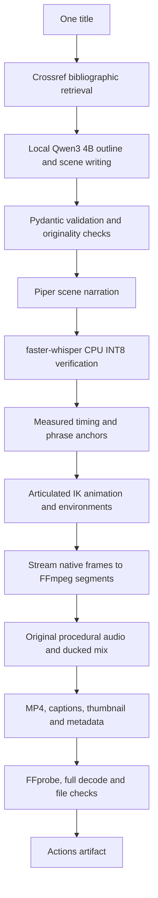

# Stickman psychology & philosophy studio

CPU-only, local-model video production with an original articulated stickman rig. **Production core verified with a 39-second native 1080p smoke test; autonomous long-form generation remains under validation.** [Validation status](docs/VALIDATION.md) separates observed results from untested features.

## One-title quick start

1. Open **Actions → Generate Stickman Video → Run workflow**.
2. Enter a title, such as **Why Smart People Overthink Everything**; leave defaults.
3. Open the successful run and download **stickman-video-output** under Artifacts.
4. Extract the archive and use `video.mp4` for upload.

Failures upload **failed-production-diagnostics**, not a successful package. A failed-run MP4 is not an approved production. GitHub login is generally required to download artifacts.

Default: native 1920×1080, 30 FPS, H.264/AAC, approximately six minutes. Workflow duration accepts 4–10 minutes. Measured narration must fall within 22% of target, or the run stops before rendering. CLI permits 0.5-minute tests. Vertical output renders natively at 1080×1920, reflows text and uses its own canvas; staging remains experimental.

[Download the verified smoke-test video and publishing package](https://github.com/justsomeoneretarded/pholosophy-psyche-stickman/actions/runs/39923854262/artifacts/12488312183). This test uses a fixed editorial fixture to isolate production; AI writing is tested separately.

## Architecture



Python handles orchestration and animation. The custom Pillow renderer samples a deterministic timeline and streams frames directly to FFmpeg. There is no browser or uncompressed frame archive. This is an engineering baseline, **not a benchmark-proven superiority claim over Remotion**.

The rig contains head, neck, torso, pelvis, shoulders, upper/lower arms, hands, hips, thighs, knees, shins and feet. Two-bone inverse kinematics preserves limb lengths. Walking/running have stance anchors, swinging feet, bent knees, torso lean and body bob. Sitting lowers hips and bends knees. Four cast colors distinguish main, friend, shadow and future self. Facial features and posture provide expression. Compatible action transitions blend and re-solve IK.

The LLM emits validated data, never executable animation code. Actions, actors, props, time intervals and coordinates are checked. Scene filenames are restricted to safe identifiers. The title is passed as JSON environment data; it is never interpolated into shell commands.

## Install and run locally

Requires Python 3.12, FFmpeg/FFprobe, DejaVu Sans, and Ollama. Install FFmpeg and `fonts-dejavu-core` through the system package manager. Install Ollama from its official site.

```bash
python -m venv .venv
source .venv/bin/activate
pip install -r requirements.txt
python -m piper.download_voices en_US-ljspeech-high --download-dir .cache/voices
ollama serve
# Another terminal:
ollama pull qwen3:4b
python -m pipeline.main --title "Why We Procrastinate" --minutes 0.75 --out outputs/smoke
python -m pytest -q
python -m scripts.demo
```

The GitHub workflow installs dependencies automatically. Lightweight tests require no AI models; they include a real FFmpeg encode/decode. The demo exports a playable motion clip, contact sheet and reports using the production engine. **Production acceptance renders** runs the procrastination smoke test plus two distinct six-minute essay titles.

## Narration and alignment

Default: Piper `en_US-ljspeech-high`, one consistent English voice without reference audio. Its [model card](https://huggingface.co/rhasspy/piper-voices/blob/main/en/en_US/ljspeech/high/MODEL_CARD) identifies the LJ Speech dataset as public domain. Piper code is GPL-3.0-or-later; weights are downloaded separately.

Change voices by downloading a permitted Piper ONNX model and setting `PIPER_VOICE` to its path, with its adjacent ONNX JSON config. `voice=custom` also requires `CUSTOM_VOICE_AUTHORIZED=true`. It means a custom Piper model, **not audio-reference cloning**. On GitHub the custom model must be supplied during setup. Normal auto narration needs no configuration.

Chatterbox Nano was not found under the PyPI name `chatterbox-nano`; that does not prove no such model exists. Chatterbox Turbo/Nano CPU inference and voice licensing were not benchmarked. Piper is the executable baseline, not the winner of an unperformed comparison.

Scene speech is checked with faster-whisper CPU INT8, word timestamps and normalized word agreement. Defective speech gets one bounded regeneration retry, then fails visibly. Speech agreement is not a pronunciation guarantee. Measured audio duration controls visual timing; exact phrase anchors refine actions when found. Subtitles follow verified transcription. Narration is never stretched to force duration.

## Visual and audio extensions

- Edit proportions, motion trajectories and IK in `pipeline/animation/rig.py`.
- Edit character faces, cast colors, environments, props, cameras and captions in `pipeline/animation/scene.py`.
- New motions need an action name, actual articulated trajectories and contact/bone-length tests.
- New props need validated kinds, geometry, interaction targets and attachment tests. Several secondary props currently share symbolic rectangle drawings.
- Add sound cues in `pipeline/production/audio.py`. Original ambient synthesis and event cues require no downloaded soundtrack. Any added recordings need documented license and attribution.
- Validated defaults live in `pipeline/config.py`. Styles influence writing direction; moods select visual palettes. Seeds control procedural randomness and model sampling, but model/dependency changes can alter results.

Walk/run, sitting, falling and gestures have articulated trajectories. Advanced interactions—handshake, push/pull, doors, climbing, released-object continuity and collision avoidance—are **experimental**. Action names alone do not establish correct physical interaction. The diagnostic's separate shots are not one uninterrupted scene.

## Research and originality limits

Crossref retrieves real DOI records and available abstracts. Bibliographic metadata does not verify claims. Current generation is therefore framed as **philosophical exploration**, not a verified scientific explanation. Writing prompts prohibit invented statistics, diagnosis, universal personality laws and attributed quotations. Prompts are not a factual verifier. `sources.json`, `claims.json` and research notes disclose the limitations.

Each title gets a fresh thesis, metaphor and outline. Scenes are written with narrative context. Persistent five-word-shingle overlap and major-scene-sequence checks reject substantial repetition. Hook/structure originality is imperfect, and cache eviction loses history; retain downloaded scripts for a durable editorial archive.

[YouTube monetization policy](https://support.google.com/youtube/answer/1311392) requires substantive originality across a channel. No monetization or virality guarantee is made.

## Delivery, QA and recovery

Successful artifacts include MP4, 1280×720 thumbnail, script, original/aligned storyboards, scene timeline, narration, SRT/VTT, captions, title/description, keywords, hashtags, pinned comment, metadata, sources, claims, research notes, audio licenses, speech/motion reports, quality report, production report/metrics, contact sheet, segments and `SUCCESS.json`.

Technical QA checks native resolution, codecs, FPS, duration, nonempty outputs and a complete FFmpeg decode. Motion sampling checks finite joints, severe displacement, disconnection, floor penetration and actor frame exit. It **does not yet comprehensively detect** text overlap, wall penetration, every attachment failure, blank frames, frozen acting or artistic continuity. Those are gaps, not passing checks.

Repeat an identical local command and output path to reuse the original storyboard, matching speech chunks and hashed encoded segments. Different configurations need a new directory. Failure artifacts preserve checkpoints; download them into a matching local output directory to resume. Automatic cross-run restoration is not implemented. Inspect `FAILURE.txt`, speech verification, motion report and scene logs.

Models run sequentially. Ollama unloads after requests. Rendering uses two FFmpeg threads, bounded scene segments and streamed frames. Model caches can be evicted or exceed cache allowances. Successful artifacts expire after 14 days; failure diagnostics after seven. CPU writing/model downloads may dominate total runtime.

GitHub [documents](https://docs.github.com/en/actions/reference/runners/github-hosted-runners) standard public Ubuntu runners at four CPUs, 16 GB RAM and 14 GB SSD. Workflows log observed resources. Public standard runners are currently free; private repositories have metered allowances. Check account usage, artifact storage and cache limits. No paid inference/rendering service is required.

## Optional YouTube upload

Disabled by default. Enable YouTube Data API v3 in a Google Cloud project, configure OAuth consent and authorize the official `youtube.upload` scope with a desktop OAuth client. Store authorized-user JSON in repository secret `YOUTUBE_OAUTH_JSON`, never in Git. Then enable the workflow upload input.

The official API uploader always uses **private** visibility. Completed and pending markers guard retries in the same output directory. An ambiguous failure needs checking in YouTube Studio before retrying. Cross-run duplicate lookup, scheduling, public publishing and thumbnail upload are not implemented. OAuth testing-token expiry, API quota and project audit restrictions still apply.

## License

Original code, procedural music and sound effects: GPL-3.0-or-later. Dependencies, model weights and system fonts retain their own terms. See `LICENSE`, `THIRD_PARTY.md`, model cards and per-run audio licenses. No copyrighted character assets are bundled.
